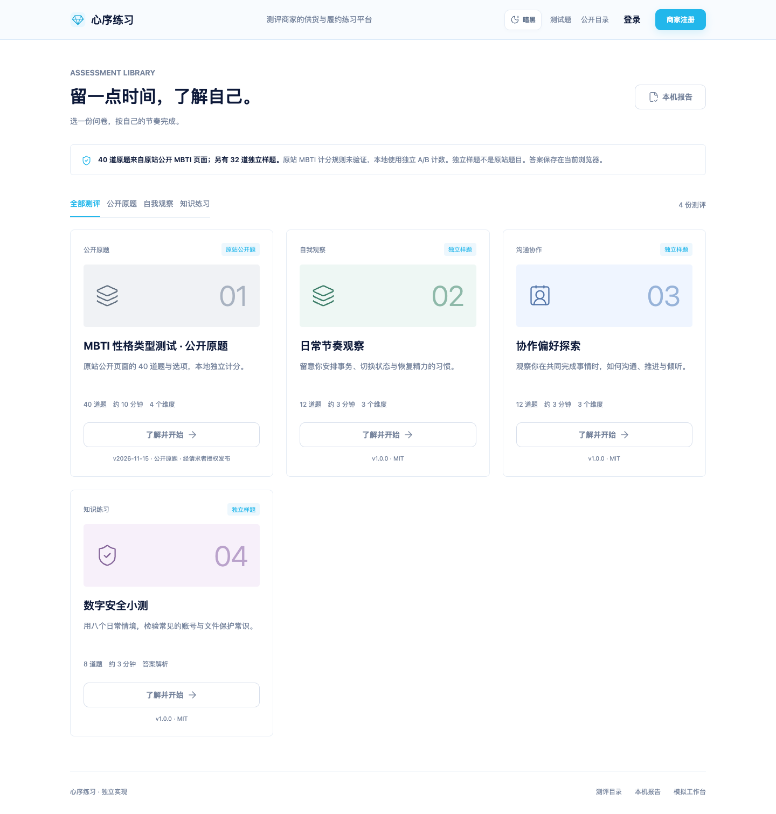

# 心序练习 / qquce Reconstruction Lab

使用 REA、Craft Anything 与 Codex 研究公开界面，并独立实现可运行的测评练习。与原站无关联，不冒充原站服务。

## 当前实现

| 内容               | 状态                                                                 |
| ------------------ | -------------------------------------------------------------------- |
| 原站公开 MBTI 问卷 | 40 道原题、选项、顺序和维度已接入                                    |
| MBTI 计分与报告    | 本项目独立 A/B 计数；原站服务器权重、平分和报告未验证                |
| 原站测评目录       | 9 个公开产品的名称、说明、题数、时长；对应完整商业题库未取得         |
| 独立练习题         | 日常节奏 12 题、协作偏好 12 题、数字安全 8 题，共 32 题              |
| 答题流程           | 逐题选择、前后切换、题号跳转、自动保存、刷新续答、漏题检查           |
| 本机报告           | 分维度结果、计分规则、逐题回顾、知识题解析、JSON 导出、浏览器打印    |
| 商家主页及账户页面 | 公开布局的独立复刻；账户、验证码、额度和授权码仍为明确标注的本地模拟 |

**没有破解登录或授权码，也没有取得原站私有源码、数据库或未公开题库。** 本地答案不发送到原站。原站公开 MBTI 40 题不等同于目录中的「16人格 · 心智阶段」48 题，两个产品没有混用。

## 启动

需要 Node.js 24+、npm。应用无数据库、付费 API 或账号依赖。

```sh
npm ci --ignore-scripts
npm start
```

默认预览为 `http://127.0.0.1:4191`，端口占用时自动选择下一个，实际地址会打印到终端。启动记录和日志在被忽略的 `.runtime/`。

```sh
npm run stop
```

前台开发：`npm run dev`，使用 Ctrl+C 停止。可以用 `PORT=5191 npm run dev` 指定起始端口。后台进程管理脚本适用于 macOS/Linux，Windows 可使用前台命令。

构建和本地生产预览：

```sh
npm run build
npm run preview
```

预览仅在启动它的电脑上运行，不保证长期在线；建立公开 GitHub 仓库不等于已部署网站。若部署 `dist/`，托管服务需要把未知前端路径回退到 `index.html`。本仓库不包含线上托管或原站后端代理。

## 页面

| 路径                               | 用途                                     |
| ---------------------------------- | ---------------------------------------- |
| `/assessments`                     | 可实际作答的题库，区分公开原题与独立样题 |
| `/mbti`、`/assessment/mbti-public` | 40 道公开原题                            |
| `/quiz`                            | 9 项原站公开目录的独立界面实现           |
| `/quiz/:code`                      | 对应产品的公开信息与未取得题库状态       |
| `/assessment/daily-rhythm`         | 独立日常节奏问卷                         |
| `/assessment/collaboration`        | 独立协作偏好问卷                         |
| `/assessment/digital-basics`       | 独立知识小测                             |
| `/reports`、`/report/:id`          | 当前浏览器中的报告                       |
| `/`、`/auth/*`、`/demo`            | 首页、模拟账户页和模拟交付工作台         |

清除浏览器站点数据会删除答案与报告；记录不跨设备同步。最近只保留 20 份完成报告。报告 URL 本身不能让其他人的浏览器读取本机记录。报告 JSON 不是防篡改凭证。

## 验证

```sh
npm run validate:banks
npm test
npm start
npm run test:browser
npm run build
```

浏览器测试默认调用本机 Chrome；也可先 `npx playwright install chromium`，然后运行 `BROWSER_CHANNEL=chromium npm run test:browser` 使用 Playwright Chromium。测试不会访问原站，会拦截外部请求。证据输出到 `artifacts/browser/`（不提交原始日志）。

本次验证包含 9 项单元测试、50 个页面/宽度组合、答题续存、漏题检查、40 题完整作答、报告导出及数据来源检查。详细结果见 [验证记录](docs/verification.md)。

## 目录与来源

- `app/src/assessment/engine.js`：计分与完整性检查。
- `app/src/assessment/banks.js`：32 道独立样题；不宣称为标准心理量表。
- `app/src/assessment/observed-bank.js`：将原站公开 JSON 转为练习引擎数据。
- `data/observed/`：40 题原始数据、9 项目录、哈希和来源说明。
- `docs/observations.md`：实际观察、推测和未确认范围。
- `docs/toolchain.md`：隔离工具链、官方资料、版本和实际验证。

新增题库需记录来源、授权范围和版本，并通过 `validateBank`。独立代码和独立样题采用 MIT；导入的原站题目与目录保留原权利，见 [来源及授权说明](data/observed/NOTICE.md)，不自动改为 MIT。

## 预览截图

截图只展示本项目的独立实现。



## 未完成

其余 9 套题库、原站真实计分模型、报告模板、动态追加题策略、商家后台和履约规则均未取得或验证。项目没有真实账号认证、邮件发送、支付、服务器保存答案或生产级授权码服务。已观察的目录和样题流程不能代替这些服务。

继续复刻商业题库需要正常可用的测评访问凭证，或有权提供的题库/计分数据；不能用猜测填补原站规则。
